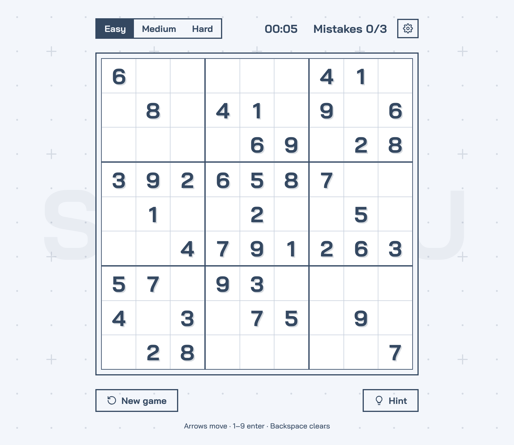

# Vanilla Sudoku

A Sudoku game with no frameworks: TypeScript, HTML and CSS, built with Vite.

Every puzzle is generated in the browser and always has exactly one solution.



## Features

- **Three levels:** Easy, Medium and Hard. Each new puzzle is generated, never loaded from a list.
- **Mistake checking:** a digit that repeats in its row, column or box turns red. Three mistakes end the game.
- **Hints:** put the correct digit in the selected cell, or in a random empty or wrong cell. Hints do not count as mistakes.
- **Timer:** pauses while the tab is hidden and stops when the game ends.
- **Highlights:** the selected cell's row, column and box, and every cell with the same digit.
- **Animations:** a finished row, column or box pulses, and a solved board plays a wave.
- **Six themes:** Classic, Pixel, Terminal, Cartoon, Brutal and Glass. Each has a light and a dark version.
- **Light, dark or auto mode:** auto follows the system setting. Your choice is saved in the browser.
- **Picture-in-picture:** in Chrome and Edge, **Pop out** keeps the game on top of other windows.
- **Keyboard, mouse and touch:** arrow keys move, 1–9 enter a digit, Backspace clears. A number pad also opens next to the selected cell.
- **Small screens:** the controls become an icon toolbar, and the board shrinks to fit.

## Getting started

You need [Node.js](https://nodejs.org/) 22.18 or newer.

```bash
npm install
npm run dev
```

Then open the address that Vite shows, usually http://localhost:5173.

| Command | What it does |
|---|---|
| `npm run dev` | Starts the development server with live reload. |
| `npm run build` | Checks the types and builds all three variants (see below). |
| `npm run build:site` / `build:bundle` / `build:pen` | Builds one variant. |
| `npm run preview` | Serves the built site from `dist/site/`. |
| `npm run check` | Runs the self-check for the puzzle logic. |

## Builds

One source, three builds:

| Variant | Output | What you get |
|---|---|---|
| site | `dist/site/` | A normal website: `index.html` plus hashed files in `assets/`. |
| bundle | `dist/bundle/` | One `sudoku.js` and one `sudoku.css`, minified, with an `index.html` that loads them. Works from any static host, or opened straight from disk. |
| pen | `dist/pen/` | The three CodePen panels: `index.html` (the body), `style.css` and `script.js`. Readable code, Brutal theme by default, author and source links, no picture-in-picture. |

Each variant turns features on or off in `vite.config.ts`. A feature that is off is left out of that build completely, with its CSS.

## How it works

1. The generator fills an empty grid with random digits, using backtracking. The result is a complete, valid solution.
2. It then removes digits, in pairs that mirror each other through the centre. After each removal, a solver counts the solutions. If there is more than one, the digits go back.
3. It stops when the puzzle has the number of givens for the level:

   | Level | Givens |
   |---|---|
   | Easy | 36–48 |
   | Medium | 30–34 |
   | Hard | 24–28 |

## Project structure

```
src/
├── core/       Puzzle logic, no DOM: level generator, solver, validation, board helpers
├── game/       Game state and the controller that connects the logic to the page
├── ui/         DOM code: element lookups, rendering, input, number pad
├── features/   Optional parts, each one module: settings, picture-in-picture, credits
├── styles/     CSS: tokens, themes/, components/, layout/, features/
└── main.ts     Entry point
tests/          Self-check for the puzzle logic
vite.config.ts  Build variants and their features
```

The `core` code does not use the DOM, so it also runs in Node. The `npm run check` self-check uses this.

`styles/index.css` imports every stylesheet in cascade order. A feature's stylesheet is imported by the feature's own module instead, so it is only built when the feature is.

## Themes

Each theme is one file in `src/styles/themes/`: a set of CSS custom properties under `:root[data-theme="…"]`. Colours use `light-dark()`, so every theme has a light and a dark version. To add a theme:

1. Copy a file in `src/styles/themes/` and change the name in its selector.
2. Import it in `src/styles/index.css`, next to the other themes.
3. Add a radio button with the same name to the settings menu in `index.html`.

## Browser support

The game uses recent web features: `light-dark()`, CSS anchor positioning, the Popover API and the `<dialog>` element. It works best in a current version of Chrome or Edge. In browsers without anchor positioning, the number pad and the settings menu can show in a different place.

Picture-in-picture uses the Document Picture-in-Picture API, which only Chromium browsers have. In other browsers, the **Pop out** button does not show.
